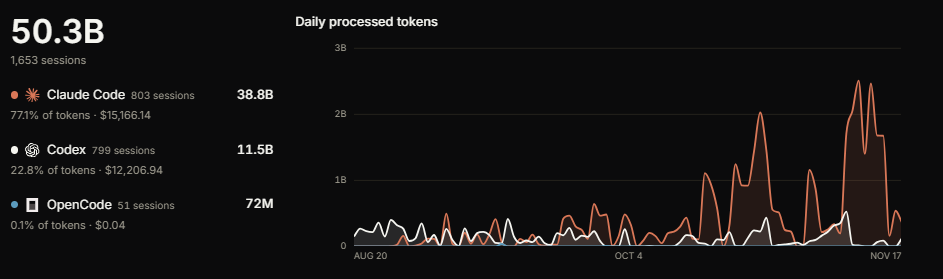

# jast-stack

hey, ich bin jacob und das hier ist mein repo für die skills und das wissen, mit denen ich an actaone arbeite. dev, infra, releases, tickets, projekte und zwischendurch auch mal ein schönes pdf.

ich benutze meine eigenen skills, aber auch die aus diesen repos:

- [tstack von theo](https://github.com/t3dotgg/tstack)
- [pstack](https://github.com/cursor/plugins/tree/main/pstack)
- [matt pococks skills](https://github.com/mattpocock/skills)

hier steckt also auch arbeit von anderen drin. die quellen, lizenzen und meine anpassungen stehen bei den jeweiligen skills. was alles drin ist, findet ihr im [katalog](catalog.md).

die [ci-docs](skills/actaone-documents/references/ci-generator.md) haben auch einen generator samt layout, logo, schriften und beispiel dabei. unter [wissen](knowledge/README.md) findet ihr die einstiege zu dokumenten, agenten-workflows und den passenden actaone-quellen.

## mein usage

50,3 milliarden verarbeitete tokens, 1.653 sessions. claude code, codex und opencode. stand vom 17.11.2026.

ich benutz die alle. aber die sind über meine projekte, meine fehler und meinen arbeitsalltag entstanden bzw. daran angepasst. nur weil etwas bei mir funktioniert, passt es noch lange nicht zu euch.

schreibt euch lieber eure eigenen skills, als meine blind zu kopieren. schaut rein, nehmt euch ideen mit und baut daraus was, das zu eurer arbeit passt. lasst eure ki mal eure sessions durchgehen: was erklärt ihr immer wieder, wo muss sie ständig nachfragen und welche fehler passieren mehrfach? genau da würde ich anfangen.

und wenn ihr euch mal richtig sicher seid, dass euer plan super ist: benutzt matts [grilling-skill](skills/grilling/SKILL.md). der ist voll gut, um euch mit den fragen zu nerven, die ihr euch selbst noch nicht gestellt habt. gerade wenn ihr von eurem plan echt überzeugt seid, lasst ihn mal dran.

## mein stack

- **harnesses:** t3 code, claude code, codex und opencode
- **modelle:** hauptsächlich astra und opus, je nach aufgabe auch andere
- **arbeitsweise:** viel subagent-nutzung und cross-harness-reviews innerhalb von t3. astra und opus im sparring oder andere konstellationen: einer baut, der andere prüft, beide diskutieren die findings
- **entwicklung:** windows (leider), powershell, wsl, git und github
- **actaone:** librechat als basis, typescript/javascript, react, node.js und mongodb
- **wissen und planung:** obsidian, markdown, postplan, zoho desk und zoho projects
- **anbindung:** mcp-server für die tools, mit denen die agenten arbeiten
- **dokumente:** pdf, docx, pptx und xlsx mit eigenen ci-vorlagen
- **trailer:** blender und ffmpeg

viel davon ist über zeit zusammengewachsen. ich nehm das, was mir gerade arbeit abnimmt, und bau den rest dazu.

prompt engineering guide: [hier entlang](https://www.instagram.com/reel/Df1cN_qu8k9/?fqnt=dTJ0a25rZXBrZzQ0).

lg jacob

## ai;dr

jacobs persönliche skills und wissenssammlung fürs arbeiten mit ki an actaone. eigene abläufe plus skills aus anderen repos. als inspiration lesen, auf die eigene umgebung anpassen und selbst prüfen. nicht blind installieren und davon ausgehen, dass alles passt.

### was man damit machen kann

die beispiele hier bündeln wiederkehrende aufgaben aus meinen sessions und zeigen, welche skills dafür zusammenpassen. das sind mögliche workflows, keine fertig getesteten automatismen.

- **„nach dem deploy fehlt plötzlich ein modell oder feature.“** mit [diagnose-instance](skills/diagnose-instance/SKILL.md) release, template, vault und laufende konfiguration vergleichen. die ursache an der dauerhaften quelle korrigieren und danach auf der betroffenen instanz prüfen. sonst ist der fix beim nächsten deploy wieder weg.

- **„was hat sich seit dem letzten kunden-release geändert und können wir das ausrollen?“** mit [cut-release](skills/cut-release/SKILL.md) änderungen und testplan zusammenbringen, zielumfang festlegen und den beauftragten rollout begleiten. danach jede zielinstanz prüfen: übersprungen ist nicht automatisch fertig. [release notes](skills/actaone-release-notes/SKILL.md) aus den tatsächlich enthaltenen änderungen ableiten.

- **„modell x soll erstmal nur auf staging laufen.“** mit [actaone-litellm](skills/actaone-litellm/SKILL.md) modell, team, key und sichtbarkeit auseinanderhalten. anschließend über [benchmarks](skills/actaone-benchmarks/SKILL.md) vergleichen, ohne einen laufenden testsuite-lauf zu verfälschen.

- **„die websuche ist langsam oder die pseudonymisierung verhält sich komisch.“** erst den richtigen dienst und clientpfad bestimmen. mit [websearch](skills/actaone-websearch/SKILL.md) suche, scraping und reranking getrennt prüfen; mit [presidio](skills/actaone-presidio/SKILL.md) anbindung und erkennerqualität. nicht einfach den erstbesten reranker oder container anfassen.

- **„können wir die alte vm jetzt abschalten?“** mit [service-rollout](skills/actaone-service-rollout/SKILL.md) prüfen, ob noch traffic oder persistente konfiguration auf den alten dienst zeigt. mit [vm-lifecycle](skills/actaone-vm-lifecycle/SKILL.md) auch branch-instanz, hotseat, archivierung und rückweg berücksichtigen. kein traffic gerade eben heißt noch nicht, dass die ressource unbenutzt ist.

- **„nutzt die testinstanz überhaupt jemand und warum sind die limits so schnell weg?“** mit [usage-analysis](skills/actaone-usage-analysis/SKILL.md) ein klares zeitfenster und passende kennzahlen auswerten. aggregate statt kundenchats lesen und interne kostenschätzungen nicht als rechnung verkaufen.

- **„aus dem supportticket wird ein größeres projekt.“** in [zoho desk](skills/actaone-zoho-desk/SKILL.md) den fall eingrenzen und einen internen antwortentwurf hinterlegen. arbeitspakete in [zoho projects](skills/actaone-zoho-projects/SKILL.md) pflegen und bei bedarf einen [postplan](skills/postplan/SKILL.md) als durchgehenden projekttracker nutzen. technische findings, entscheidungen und abnahmen dort weiterführen, statt jedes mal einen neuen plan anzulegen.

- **„mach aus den ergebnissen ein ordentliches ci-pdf.“** inhalte und belegte zahlen zusammenstellen, mit dem [dokument-skill](skills/actaone-documents/SKILL.md) ins vorhandene layout bringen und über den generator ausgeben. jede seite ansehen, quelle behalten, pdf übergeben. das neutrale beispiel ist dabei, meine ursprünglichen berichtsdaten nicht.

und quer durch alles: größere aufgaben auf subagents verteilen, astra und opus innerhalb von t3 gegenseitig reviewen lassen und findings gegen code oder tests auflösen. was dabei dauerhaft nützlich ist, über [kb-pflege](skills/actaone-kb-maintenance/SKILL.md) festhalten. damit die nächste session nicht wieder dieselben zugänge, entscheidungen und fehler neu entdecken muss.
